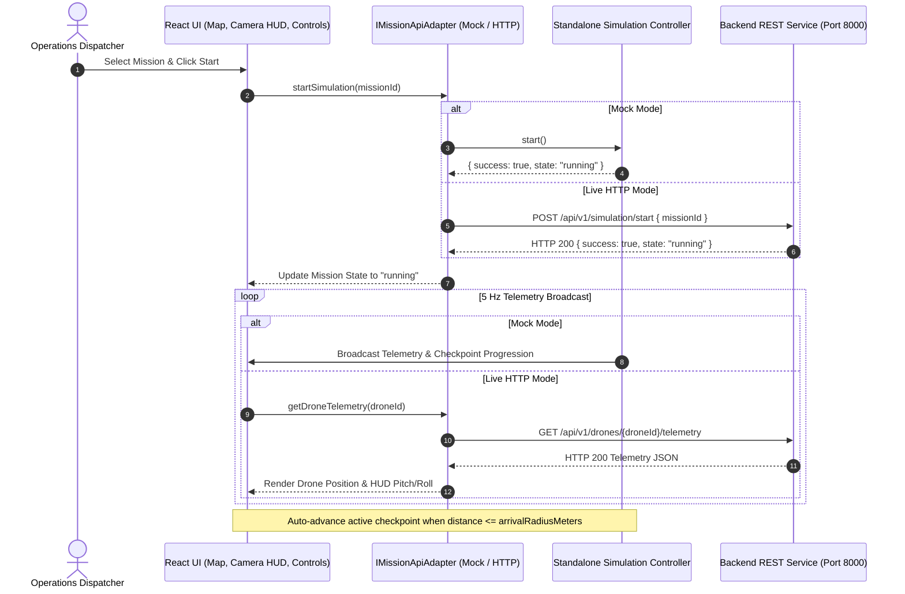

# AEROVATA Backend API Contract & Simulation Architecture Specification

> **Platform:** AEROVATA by TASPORA — Autonomous Drone Delivery Command Center  
> **Protocol:** RESTful JSON over HTTP / WebSocket Telemetry  
> **Version:** 1.0.0  
> **Base URL (Configurable):** `http://localhost:8000/api/v1` (Default) or configurable in UI / `.env` via `VITE_API_BASE_URL`  
> **Safety Notice:** *This simulation controller and API contract are designed for software demonstration and simulation only. Do not issue commands to physical aircraft.*

---

## 1. System Architecture & Interaction Flow

The frontend is completely decoupled from the backend implementation via the typed adapter pattern (`IMissionApiAdapter`). The system can operate seamlessly in two modes:
1. **Mock In-Memory Adapter (`MockMissionApiAdapter`)**: Embedded headless simulation controller (`SimulationMissionController`) running client-side for offline development, local showcase, and unit testing.
2. **Production HTTP Adapter (`HttpMissionApiAdapter`)**: Communicates with the external FastAPI / Node backend service over standard REST endpoints.



---

## 2. REST Endpoints Specification

### Endpoint 1: Retrieve Mission Checkpoints
* **Method:** `GET`
* **Route:** `/api/v1/missions/{missionId}/checkpoints`
* **Description:** Retrieves the chronological sequence of checkpoints for a flight mission.

#### Request Parameters
| Parameter | In | Type | Required | Description |
| :--- | :--- | :--- | :--- | :--- |
| `missionId` | Path | `string` | Yes | Unique mission identifier (e.g. `MSN-TAS-01`) |

#### Response: `200 OK`
```json
{
  "missionId": "MSN-TAS-01",
  "totalCheckpoints": 6,
  "checkpoints": [
    {
      "id": "cp-hosp-01",
      "sequence": 1,
      "name": "Taspora Hub Alpha Pad 1",
      "lat": -37.8155,
      "lng": 145.1220,
      "altitudeMeters": 0.0,
      "targetSpeedKmh": 42.0,
      "arrivalRadiusMeters": 8.0,
      "dwellTimeSeconds": 0,
      "action": "takeoff",
      "status": "reached",
      "etaSeconds": 0,
      "notes": "Initial climb to 85m AGL after ground clearance"
    },
    {
      "id": "cp-hosp-02",
      "sequence": 2,
      "name": "Transit Waypoint Bravo",
      "lat": -37.8138,
      "lng": 145.1238,
      "altitudeMeters": 85.0,
      "targetSpeedKmh": 50.0,
      "arrivalRadiusMeters": 10.0,
      "dwellTimeSeconds": 0,
      "action": "transit",
      "status": "active",
      "etaSeconds": 45,
      "notes": "BVLOS West Corridor entry waypoint"
    },
    {
      "id": "cp-hosp-03",
      "sequence": 3,
      "name": "Ridge Corridor North Checkpoint",
      "lat": -37.8118,
      "lng": 145.1248,
      "altitudeMeters": 88.0,
      "targetSpeedKmh": 48.0,
      "arrivalRadiusMeters": 10.0,
      "dwellTimeSeconds": 2,
      "action": "hover_inspect",
      "status": "pending",
      "etaSeconds": 95,
      "notes": "Micro-radar safety check prior to hospital airspace"
    },
    {
      "id": "cp-hosp-04",
      "sequence": 4,
      "name": "St. Jude Trauma Helipad Drop Point",
      "lat": -37.8098,
      "lng": 145.1272,
      "altitudeMeters": 45.0,
      "targetSpeedKmh": 28.0,
      "arrivalRadiusMeters": 6.0,
      "dwellTimeSeconds": 4,
      "action": "drop_payload",
      "status": "pending",
      "etaSeconds": 160,
      "notes": "Autonomous package tether winch release; recipient PIN verified"
    }
  ]
}
```

---

### Endpoint 2: Retrieve Mission Status
* **Method:** `GET`
* **Route:** `/api/v1/missions/{missionId}/status`
* **Description:** Retrieves the high-level operational lifecycle status, progress percentage, and time remaining.

#### Response: `200 OK`
```json
{
  "id": "MSN-TAS-01",
  "title": "St. Jude Trauma Hospital Emergency Rapid Response",
  "description": "High-priority autonomous BVLOS delivery of emergency O-negative blood units.",
  "priority": "URGENT",
  "droneId": "AV-01",
  "droneCallsign": "DRONE 01",
  "status": "running",
  "currentCheckpointIndex": 2,
  "totalDistanceMeters": 2840,
  "elapsedTimeSeconds": 48,
  "estimatedRemainingSeconds": 192,
  "progressPercent": 33,
  "dwellRemainingSeconds": 0,
  "errorMessage": null
}
```

#### Possible Values for `status`
- `idle`: Mission loaded; aircraft stationary at starting checkpoint.
- `running`: Aircraft traversing checkpoints or executing dwell loiters.
- `paused`: Mission paused by operator; aircraft holds position/auto-hover.
- `completed`: All checkpoints reached and final action concluded.
- `aborted`: Return-to-base commanded or mission canceled.
- `error`: Input validation failure or simulated subsystem fault.

---

### Endpoint 3: Retrieve Drone Telemetry
* **Method:** `GET`
* **Route:** `/api/v1/drones/{droneId}/telemetry`
* **Description:** High-frequency telemetry stream providing GPS positioning, altitude, heading, airspeed, battery vitals, and proximity to active checkpoint.

#### Response: `200 OK`
```json
{
  "droneId": "AV-01",
  "timestamp": 1793751280000,
  "lat": -37.812345,
  "lng": 145.125678,
  "altitudeMeters": 88.0,
  "headingDegrees": 34,
  "groundSpeedKmh": 46.5,
  "verticalSpeedMs": 0.2,
  "batteryPercentage": 88.0,
  "batteryVoltage": 24.2,
  "signalQualityPercent": 96,
  "rtkFix": "RTK_FIX",
  "satellites": 18,
  "currentCheckpointIndex": 2,
  "distanceToNextCheckpointMeters": 142,
  "missionStatus": "running",
  "isDwellActive": false
}
```

---

### Endpoint 4: Retrieve Camera Feed Connection Metadata
* **Method:** `GET`
* **Route:** `/api/v1/drones/{droneId}/camera`
* **Description:** Returns optical sensor connection status, video stream endpoint, framerate, latency, and mandatory synthetic simulation disclaimers.

#### Response: `200 OK (Synthetic Demo Fallback)`
```json
{
  "droneId": "AV-01",
  "connectionStatus": "FALLBACK_SIMULATION",
  "streamUrl": null,
  "resolution": "1920x1080",
  "fps": 60,
  "latencyMs": 85,
  "codec": "H.264 / AVC High@L4.2",
  "isSimulated": true,
  "disclaimer": "DEMO VIDEO FALLBACK / SYNTHETIC SENSOR SIMULATION - NOT LIVE FOOTAGE"
}
```

#### Response: `200 OK (Live External Stream)`
```json
{
  "droneId": "AV-01",
  "connectionStatus": "CONNECTED",
  "streamUrl": "https://video.taspora.aero/live/av01/index.m3u8",
  "resolution": "1920x1080",
  "fps": 60,
  "latencyMs": 62,
  "codec": "H.264",
  "isSimulated": false,
  "disclaimer": ""
}
```

#### Response: `200 OK (Disconnected Sensor)`
```json
{
  "droneId": "AV-01",
  "connectionStatus": "DISCONNECTED",
  "streamUrl": null,
  "resolution": "0x0",
  "fps": 0,
  "latencyMs": 0,
  "codec": "NONE",
  "isSimulated": false,
  "disclaimer": "CAMERA HARDWARE OFFLINE"
}
```

---

### Endpoint 5: Start Simulation
* **Method:** `POST`
* **Route:** `/api/v1/simulation/start`
* **Description:** Initiates or resumes mission execution. Validates mission inputs prior to transition.

#### Request Body
```json
{
  "missionId": "MSN-TAS-01"
}
```

#### Response: `200 OK`
```json
{
  "success": true,
  "state": "running",
  "message": "Simulation started successfully"
}
```

#### Error Response: `422 Unprocessable Entity (Invalid Mission)`
```json
{
  "success": false,
  "state": "error",
  "message": "Validation Error: Checkpoint #2 has invalid altitude: -45m. Altitude cannot be negative."
}
```

---

### Endpoint 6: Pause Simulation
* **Method:** `POST`
* **Route:** `/api/v1/simulation/pause`
* **Description:** Commands auto-hover; velocity set to 0.

#### Request Body
```json
{
  "missionId": "MSN-TAS-01"
}
```

#### Response: `200 OK`
```json
{
  "success": true,
  "state": "paused",
  "message": "Simulation paused"
}
```

---

### Endpoint 7: Reset Simulation
* **Method:** `POST`
* **Route:** `/api/v1/simulation/reset`
* **Description:** Resets mission checkpoints to pending, rewinds aircraft to checkpoint 1, restores battery and elapsed time.

#### Request Body
```json
{
  "missionId": "MSN-TAS-01"
}
```

#### Response: `200 OK`
```json
{
  "success": true,
  "state": "idle",
  "message": "Simulation reset to origin checkpoint"
}
```

---

## 3. Mission Validation Rules & Error Handling

To ensure flight envelope safety, the controller and backend reject invalid payloads and immediately enter state `'error'`:

1. **Checkpoint Count:** Minimum 2 checkpoints (origin and destination).
2. **Coordinate Ranges:** Latitude must be within `[-90.0, 90.0]`; Longitude within `[-180.0, 180.0]`.
3. **Altitude Floor:** `altitudeMeters >= 0.0`. Negative altitudes trigger rejection.
4. **Airspeed Limits:** `targetSpeedKmh` must be between `1.0` and `200.0 km/h`.
5. **Arrival Radius:** `arrivalRadiusMeters > 0.0`.
6. **Consecutive Duplicate Coordinates:** Consecutive checkpoints must be at least `0.5m` apart.

---

## 4. How the Frontend, API, and Controller Interact

1. **User Action / Route Navigation:**
   - Navigating to `/live-camera` loads `LiveCameraScreen` with the HUD overlay.
   - Operating in the main console renders `MapWorkspace` displaying ordered numbered checkpoint badges and the glowing flight corridor.
2. **Adapter Layer (`apiService`):**
   - Dispatches requests either to `MockMissionApiAdapter` or `HttpMissionApiAdapter`.
   - Base URL is dynamic and configurable on the fly via the UI.
3. **Standalone Simulation Controller (`SimulationMissionController`):**
   - Runs a 5 Hz deterministic kinematic ticker.
   - Computes distance to active checkpoint using Haversine formula and bearing via spherical trigonometry.
   - Evaluates arrival radius: when reached, manages dwell time, marks checkpoint `reached`, and advances `currentCheckpointIndex`.
   - On mission completion, automatically transitions state to `completed`.
